<!-- _class: lead cover -->

# 5. &nbsp; Loop

 

[Hengfeng Wei (魏恒峰)](https://hengxin.github.io/)
hfwei@hnu.edu.cn

Oct. 29, 2026

---
# Review
 
 

## `for` Statement
## Nested Loops

---
# Overview

### Loops (More Examples)
 

### vector

### Multi-dimensional Arrays (多维数组)

---

## <mark>josephus.cpp &ensp; game-of-life.cpp</mark>
## <mark>insertion-sort.cpp &ensp; bubble-sort.cpp</mark>

---

## <mark>''I hate the Josephus Game!''</mark>

---

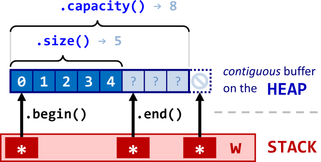

---

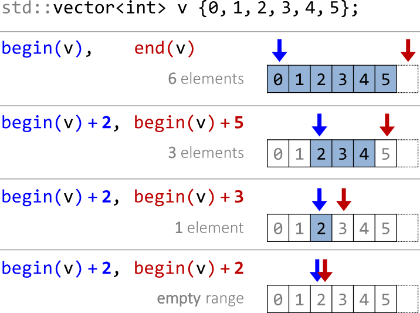

---

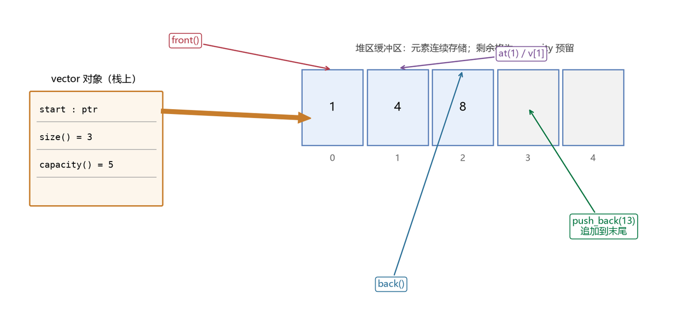

---

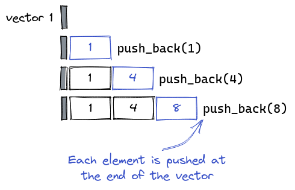

---

---

## $J(2^m + l) = 2l + 1 \quad {\small (m \ge 0 \land 0 \le l < 2^m)}$

### $J(12) = J(2^3 + 4) = 2 \times 4 + 1 = 9$

---
# [Conway's Game of Life @ wiki](https://en.wikipedia.org/wiki/Conway%27s_Game_of_Life)

#### John Horton Conway ($1937 \sim 2020$)

---
### [playgameoflife.com (Cellular Automata; 元胞自动机)](https://playgameoflife.com/)
 
 

* Any **live** cell with two or three live neighbours survives.
* All other **live** cells die in the next generation.
 

* Any **dead** cell with three live neighbours becomes a live cell.
* All other **dead** cells stay dead.

---

### [Glider](https://playgameoflife.com/)

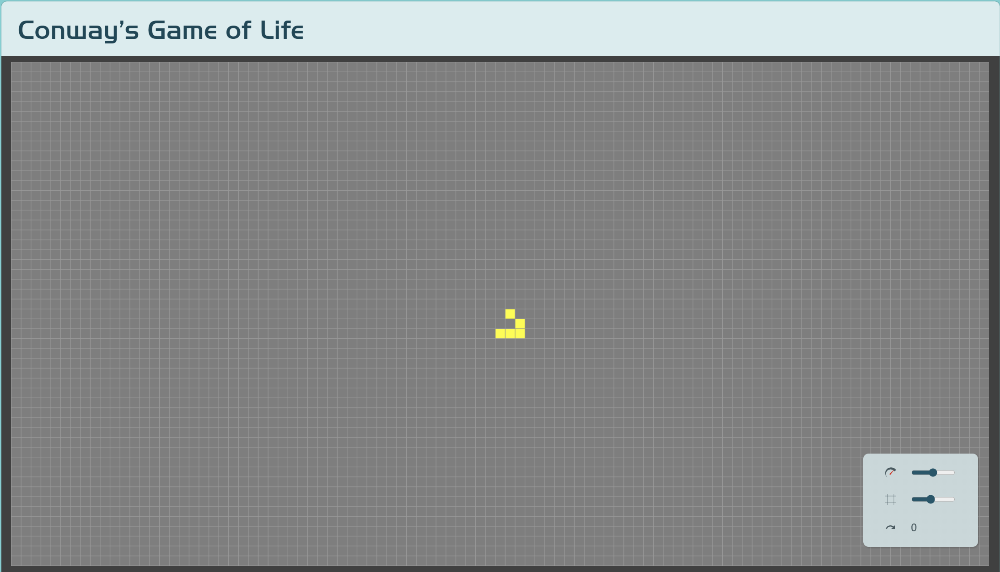

---

### [Gosper glider gun](https://en.wikipedia.org/wiki/Gun_(cellular_automaton))

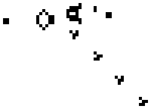

---
### [Puffer-type breeder](https://en.wikipedia.org/wiki/Puffer_train)

---
<video control width = "1100"> <source src="videos/Conway-Game-of-Life.mp4" type = "video/mp4"> </video>

---
# [Insertion Sort](https://en.wikipedia.org/wiki/Insertion_sort)
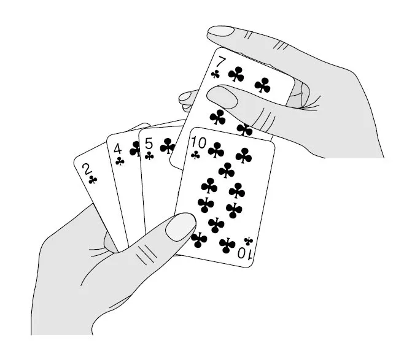

---
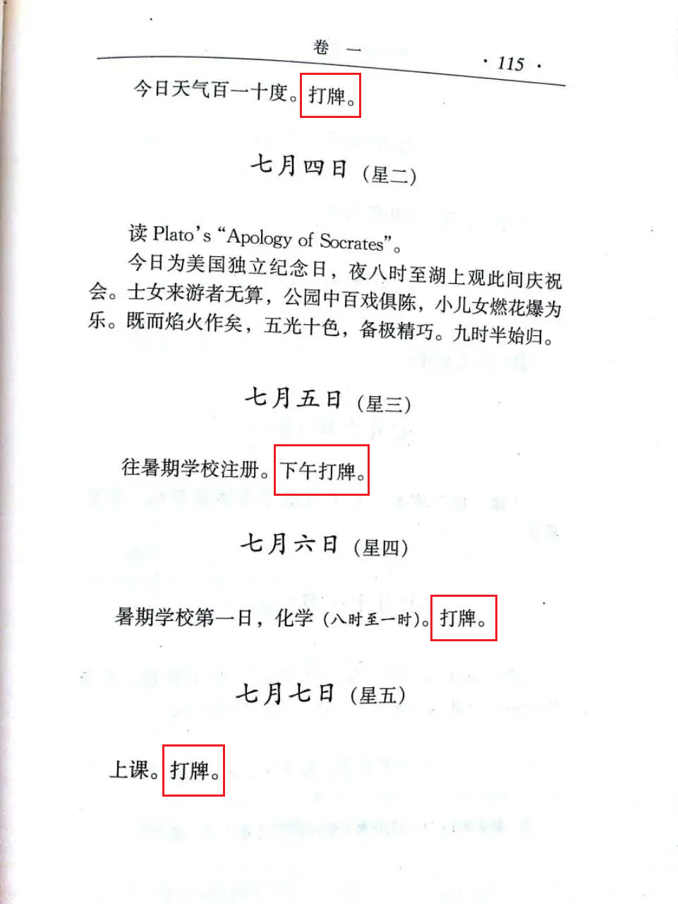 &ensp; 

---

---
 

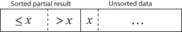

 

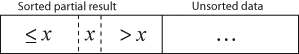

---
# [Bubble Sort](https://en.wikipedia.org/wiki/Bubble_sort)

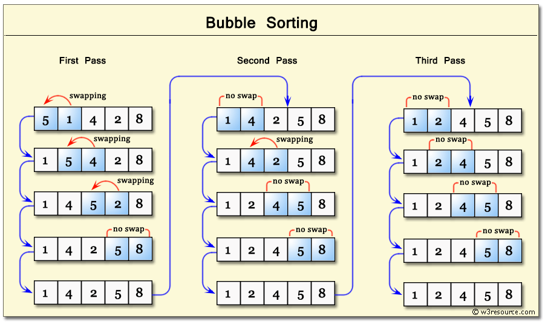

---

---
