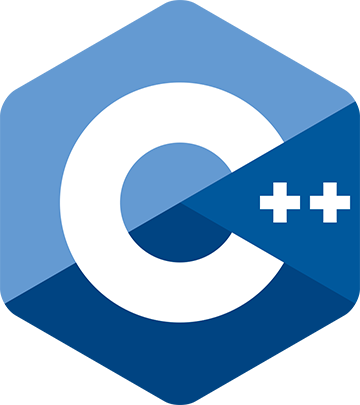
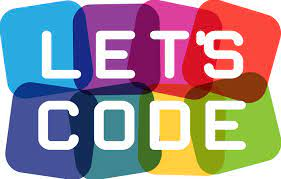
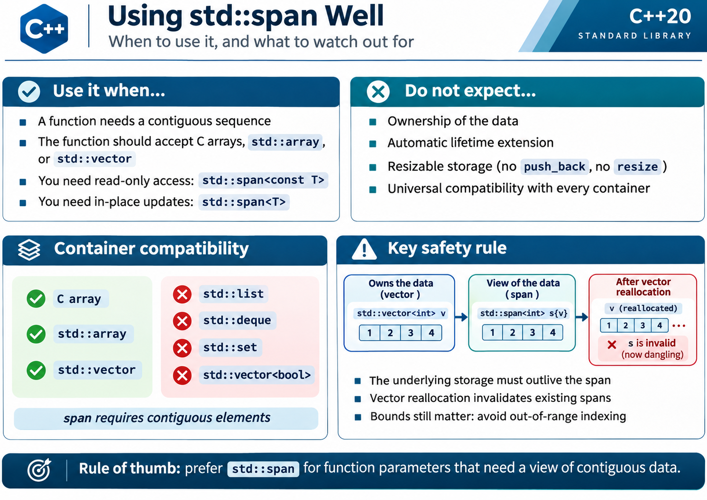

<!-- _class: lead cover -->

# 6. &nbsp; Function

 

[Hengfeng Wei (魏恒峰)](https://hengxin.github.io/)
hfwei@hnu.edu.cn

Nov. 02, 2026

---
# Overview

 

# Functions

 

### Function Definition
### Function Declaration
## <mark>Pass by Value/Reference/Const Reference</mark>

---

---

 Re-writing Programs using Functions

---

---
